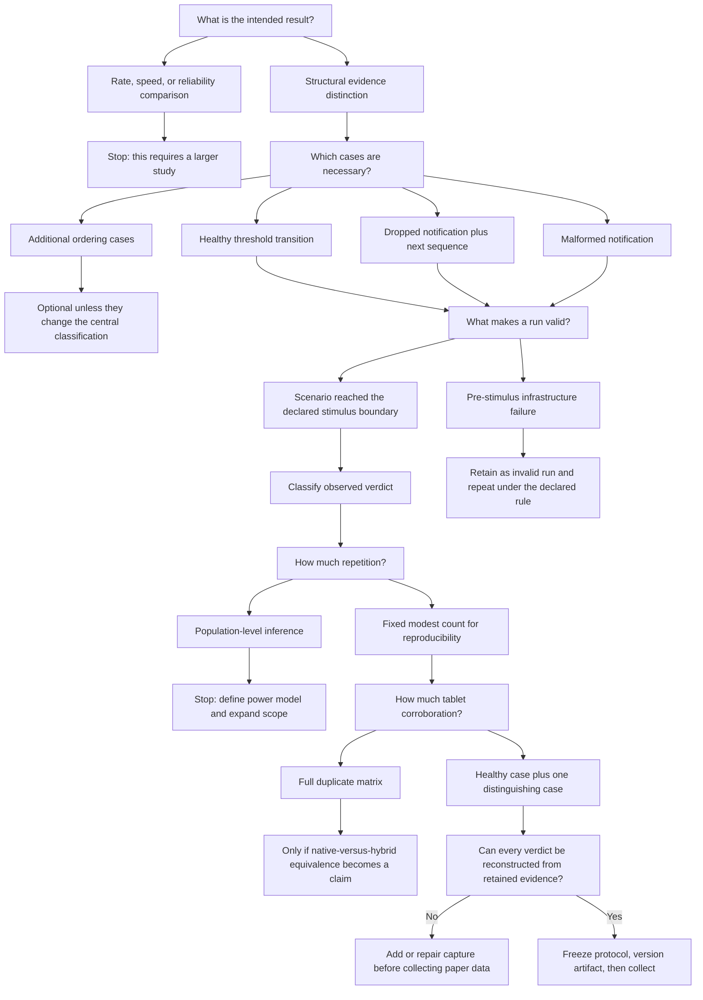

# Pilot protocol decision tree

This document separates decisions that require author judgment from mechanical
implementation choices. Its purpose is to freeze a compact, auditable study
without turning SeamScope into a performance benchmark.

> **Decision status (2026-10-22): protocol frozen.** The study
> framing, core cases, target of 10 valid repetitions, tablet-reference scope,
> validity/retry rule, and balanced-ordering strategy below are approved.
> Calibration established hard harness limits of 8,000 ms for BLE
> subscription readiness and 2,000 ms for a post-stimulus application
> transition. No calibration run is part of the confirmatory paper dataset.
> The executable source and configuration are identified by the aggregate
> source hash and artifact hashes in
> `artifacts/evidence/pilot-v1/freeze-metadata.json`; the first Git commit may
> reproduce that snapshot but is not a prerequisite for collection. A
> post-freeze change creates a new protocol version and is disclosed.

## Current study decision

The paper's center is the **claim-driven placement procedure**. SeamScope is a
worked demonstrator used to make the procedure observable and falsifiable; it
is not presented as a realistic vehicle, ECU, ELD, or regulatory test system.

The primary empirical contrast is between semantic injection and
serial-controlled BLE delivery on the same Pixel emulator. The hybrid route is
an instance of **claim-driven boundary placement**: it virtualizes the mobile
device while retaining the physical USB Bluetooth controller, radio path, and
Arduino peripheral relevant to the broader delivery claim. This is not a claim
that a route becomes better merely by containing more physical hardware.

Apparatus-lifecycle failures observed during calibration are retained as
qualification evidence. They may support a bounded secondary observation
about layered readiness and observability, but they are not application
failures, do not enter behavioral latency summaries, and do not by themselves
validate the decision procedure.

## Decisions already settled

- The study demonstrates a structural evidence distinction; it does not
  estimate relative defect-detection or failure rates.
- The principal comparison uses the same Pixel emulator, application build,
  Appium scenario, page objects, and UI oracle.
- The manipulated factor is the signal route: semantic injection or
  serial-controlled BLE delivery through Bumble and the physical controller.
- The Samsung tablet is a reference route and is not pooled with the primary
  emulator comparison.
- The apparatus is a fictional motion-monitoring application, not an ELD,
  vehicle model, ECU emulator, or compliance system.
- USB serial is the fixture-control and instrumentation channel. BLE is the
  additional evidence path. Appium observes the application-level result.
- Route adequacy is assessed property by property against the intended evidence
  claim, rather than by assigning an overall fidelity label to a route.
- The nine selected valid Bumble/BLE runs and eight retained pre-stimulus
  setup failures from `pilot-v1` are calibration observations only.

## Decision tree



## Recorded protocol decisions

The choices in this section are accepted pre-freeze decisions. They remain
changeable only until the freeze gate is completed, and any revision must be
made for a methodological or operational reason rather than in response to the
direction of observed results.

### 1. Core case set -- decided

Use three core cases.

1. **Healthy threshold transition:** deliver 8 followed by 0 and observe the
   In Motion view followed by one completed motion interval.
2. **Dropped notification plus recovery:** acknowledge and drop one fixture
   observation, verify that the application does not transition, then deliver
   the next observation and correlate the visible sequence gap.
3. **Malformed notification:** transmit a payload that violates the declared
   BLE grammar and verify rejection without a valid state transition.

Keep a separately injected stale-sequence case as an artifact test or secondary
case. It exercises an application rule shared by both routes, but it is less
central to the bypassed-boundary argument. Promote it only if we decide the
paper needs a second example of claim-relative route adequacy.

The cases are not artificially made symmetrical across routes. A dropped or
malformed BLE notification is absent by construction from semantic injection;
creating a malformed deep link would exercise a different parser and therefore
a different claim.

| Case | Injected Pixel | Bumble/BLE Pixel | Tablet reference |
|---|---|---|---|
| Healthy threshold | Primary comparison | Primary comparison | Reference case |
| Dropped notification and recovery | Not applicable; BLE boundary bypassed | Primary distinguishing case | Optional |
| Malformed notification | Not applicable; BLE boundary bypassed | Primary distinguishing case | Reference case |
| Stale semantic sequence | Optional shared-rule case | Optional shared-rule case | Not required |

### 2. Repetition count -- decided

Conduct one retained but non-confirmatory dry run per condition after the
capture machinery is complete. Freeze the protocol, and then collect 10 valid
runs per core condition in each applicable primary route.

Ten is a fixed reproducibility check, not a sample justified for population
inference. Report counts and all deviations descriptively. Do not calculate a
general failure rate or claim statistical superiority.

### 3. Tablet reference scope -- decided

Repeat the healthy case and the malformed case on the tablet. This
corroborates the shared behavior and payload-contract boundary through a native
Android Bluetooth controller.

Do not duplicate the complete matrix unless the paper begins to claim
equivalence between the native tablet and Bumble-backed emulator routes.

### 4. Timeout semantics -- calibrated and decided

Use the following distinct values and meanings:

| Measure | Performance target | Hard harness limit |
|---|---:|---:|
| BLE subscription readiness | 3,000 ms | 8,000 ms |
| Post-stimulus application display | 1,000 ms | 2,000 ms |
| Dropped-notification negative window | 2,000 ms | Not applicable |

The performance targets are descriptive thresholds. Exceeding one does not
make a run invalid and does not imply that the expected observation was absent.
The hard harness limits control when the runner stops waiting. These values
were selected from retained calibration observations and must not be extended
after a confirmatory run has started.

- Failure before connection/subscription readiness is an infrastructure or
  setup outcome unless connection establishment is the case under test.
- Absence of the expected application transition after a valid stimulus is a
  test result, not an infrastructure discard.
- A timeout may not be extended after seeing a failing paper-data run.

### 5. Invalid-run and retry rule -- decided

A run is valid once the case's declared stimulus boundary has been reached.
Before that boundary, a verified executor failure such as an
unavailable COM port, emulator boot failure, or occupied USB-controller handle
is retained and classified as invalid; it may be repeated. After that boundary,
unexpected silence, rejection, disconnect, or timeout remains part of the
observed result unless evidence proves the scenario itself never issued the
stimulus.

Every retry receives a new run identifier. Invalid runs and manual
interventions remain in the archive and summary; they are never silently
deleted or overwritten.

### 6. Run ordering -- strategy decided, sequence pending

Use a predeclared balanced sequence rather than ad hoc ordering or complicated
randomization. Alternate the two applicable routes for the healthy Pixel case,
rotate the starting route across repetitions, and interleave the BLE-only fault
cases in predeclared blocks. Reset fixture and application state before every
run.

This limits simple order and warm-state effects without suggesting a powered
randomized experiment.

The exact ordered run list must be generated and stored in the study manifest
before protocol freeze. Collection follows that list; convenience, a recent
failure, or an attractive result is not a reason to reorder it silently.

## Operational validity boundary

A run crosses the `stimulus-issued` validity boundary when the runner retains
evidence that the case's first deliberate stimulus was accepted by its route:

- for semantic injection, the injection command was issued successfully to the
  configured application instance; or
- for a BLE case, the fixture acknowledged the outcome-bearing transmission
  command and the runner recorded that acknowledgement. A fault case also
  requires the preceding fault-arming acknowledgement; arming alone does not
  cross the boundary.

Failures before this point are retained as `invalid / not-evaluated` and may
be repeated with a new run identifier. After this point, silence, rejection,
disconnect, timeout, or an unexpected UI state is an observed test outcome
unless retained evidence shows that the stimulus was never issued. A later
successful recovery does not erase the earlier run.

## Next-work sequence

This is the shortest path from the completed calibration to paper data. Do not
skip ahead to confirmatory repetitions merely because the apparatus is already
running.

> **Progress (2026-10-21): all planned non-confirmatory dry runs complete.**
> `dryrun-healthy-injected-003` produced a valid passing archive for the
> healthy injected route. Stimulus-to-moving was approximately 917.3 ms and
> stop-stimulus-to-completed-interval was approximately 839.2 ms, both within
> the 2,000 ms hard display limit. Attempts `001` and `002` remain archived as
> `invalid / not-evaluated`: the first exposed an obsolete Android SDK
> environment path, and the second exposed accidental use of the
> post-stimulus limit for initial app readiness. The latter led to separating
> the 45,000 ms app-readiness allowance from the 2,000 ms transition limit.
> The passing scenario also exposed a post-session Windows cleanup issue. It
> was resolved by running Appium as an explicitly owned child process and
> giving WDIO an external Appium endpoint. The managed runner now terminates
> that exact child and waits for exit instead of relying on Windows process-tree
> termination.
>
> The Bumble/BLE dry runs then produced valid passing archives for healthy
> (`dryrun-healthy-bumble-001`), dropped/recovery
> (`dryrun-dropped-bumble-001`), and malformed/recovery
> (`dryrun-malformed-bumble-002`). The malformed attempt ending in `001` is
> retained as `invalid / not-evaluated`: the daemon TCP port was accidentally
> supplied as the Windows serial-port name, so setup failed before stimulus.
> This led to making daemon mode independent of `SEAMSCOPE_SERIAL_PORT` and to
> documenting the two endpoints separately.
>
> The tablet reference then produced valid passing archives for healthy
> (`dryrun-healthy-tablet-001`) and malformed/recovery
> (`dryrun-malformed-tablet-001`). The healthy run subscribed in approximately
> 4,456.7 ms, displayed motion in 1,053.3 ms, and completed the interval in
> 956.9 ms. The malformed run subscribed in 2,119.0 ms, displayed rejection in
> 1,124.6 ms, recovered motion in 1,332.4 ms, and completed the interval in
> 854.8 ms. Values above their performance targets remained within the frozen
> hard limits and did not change run validity. Neither run required manual
> intervention.

1. **Complete the injected-route dry run.** **Completed 2026-10-21.** Execute
   the healthy threshold case on the Pixel emulator with the same application
   build, Appium page objects, scenario assertions, and UI oracle used by the
   Bumble/BLE route. Confirm that the archive makes both the common behavioral
   result and the bypassed BLE boundary explicit.
2. **Complete applicable non-confirmatory dry runs.** **Completed
   2026-10-21.** Healthy, dropped/recovery, and malformed/recovery were
   exercised on Bumble/BLE; healthy and malformed/recovery were exercised on
   the tablet reference. The dropped and malformed cases are not manufactured
   for semantic injection, because doing so would exercise a different parser
   rather than the BLE boundary.
3. **Prove artifact sufficiency.** **Completed 2026-10-21.** The deliberately
   failing run `dryrun-controlled-poststimulus-drop-tablet-001` was
   reconstructed as `valid / fail` at the fixture boundary from its archived
   artifacts alone. Its controlled cause is declared through the
   `samsung-sm-t220-nativeble-nano-controlled-drop` configuration and retained
   fault events; it is not a discovered application defect.
4. **Freeze the study configuration.** Record protocol version, exact run
   order, repository state, dependency and device versions, APK and firmware
   hashes, timeout values, reset procedure, and configuration identifiers in
   the study manifest.
5. **Collect the confirmatory dataset.** Follow the frozen order until each
   applicable primary-route condition has 10 valid runs. Preserve every
   invalid attempt, intervention, and retry. Collect the two tablet-reference
   cases separately and do not pool them with the Pixel comparison.
6. **Generate, do not hand-curate, summaries.** Produce the run and case tables
   from immutable manifests, normalized events, and verdicts. Report
   behavioral observations separately from pre-stimulus apparatus outcomes.
7. **Translate the result into the paper.** Build the paired-route result table,
   claim-versus-route matrix, and route diagram before revising Methods,
   Results, limitations, and finally the abstract.

### Immediate stopping rule

If a dry run cannot be reconstructed from its archive, or if recovery requires
an undocumented manual action, stop collection and repair the capture or reset
procedure. Such a change is expected before freeze; after freeze it requires a
new disclosed protocol version.

### Controlled post-stimulus failure reconstruction

`dryrun-controlled-poststimulus-drop-tablet-001` executes the declared healthy
tablet case with `SEAMSCOPE_CONTROLLED_FAULT=DROP_NEXT`. The hook arms the
firmware immediately before the ordinary `SPEED 8` stimulus; it does not alter
the frozen 2,000 ms display limit or the ordinary motion assertion.

The retained run supports the following reconstruction without operator
memory:

| Question | Retained evidence | Reconstruction |
|---|---|---|
| Was setup ready? | `setup-ready`, BLE connection, and subscription in 2,089.5 ms | Yes; the run reached a subscribed application state. |
| Was the fault intentional? | Configuration ID plus `OK FAULT DROP_NEXT` | Yes; notification suppression was the declared controlled cause. |
| Did the run cross the validity boundary? | `stimulus-issued` sequence 1 and `OK SPEED 8.0` | Yes; classify the observation rather than discard the run. |
| What happened at the exercised boundary? | Firmware event `DROP 1`; no `TX 1` or notification-success event | The fixture suppressed sequence 1 before BLE delivery. |
| What did the application show? | Failed 2,000 ms motion assertion and `failure-ui.xml` containing `SUBSCRIBED`, `Stopped`, and zero completed intervals | The expected healthy transition was absent. |
| Was cleanup independent of the failure? | Appium log returns the route to `IDLE`; the managed runner exits and releases port 4723 | Yes; scenario failure did not prevent teardown. |

The verdict is therefore `valid / fail`, with `failureBoundary: fixture`. The
healthy-transition claim is not supported for this deliberately altered
configuration. This result must not be counted with either confirmatory
healthy runs or discovered defects.

## Proposed evidence schema

During development, each run is stored in an immutable directory under the
git-ignored `artifacts/evidence` path. A frozen study export retains the same
layout in the archived research artifact:

```text
artifacts/evidence/<study-id>/
  study-manifest.json
  runs/
    <run-id>/
      manifest.json
      events.jsonl
      verdict.json
      serial.log
      appium.log
      logcat.log
      bumble.log          # BLE emulator route only
      start.png
      final.png
      failure.png         # when applicable
      failure-ui.xml      # when applicable
  derived/
    run-summary.csv
    case-summary.csv
```

Raw run directories are append-only. Files under `derived/` may be regenerated
from the manifests, normalized events, and verdicts.

### Study manifest

The study-level manifest records:

- protocol version and freeze timestamp;
- repository commit and dirty-state declaration;
- declared research questions and cases;
- repetition target and predeclared run order;
- timeout values, validity boundary, and retry rule;
- application, automation, firmware, Arduino core, Appium, WebdriverIO,
  UiAutomator2, Bumble, emulator, and Android versions;
- identities of the Nano, USB Bluetooth controller, emulator profile, and
  tablet model; and
- hashes of the application package and firmware binary used for collection.

### Run manifest

Each run manifest records at least:

```json
{
  "schemaVersion": "1",
  "runId": "...",
  "protocolVersion": "...",
  "caseId": "healthy-threshold",
  "route": "injected | bumble-ble | tablet-ble",
  "repetition": 1,
  "startedAt": "RFC-3339 timestamp",
  "configurationId": "...",
  "validityBoundary": "stimulus-issued",
  "retryOf": null
}
```

Environment details should normally be referenced through `configurationId`
rather than recopied inconsistently into every file.

### Normalized event record

`events.jsonl` joins observations without pretending that every component
shares a clock:

```json
{
  "schemaVersion": "1",
  "runId": "...",
  "eventIndex": 12,
  "source": "fixture | appium | app | bumble | runner",
  "eventType": "command-accepted | tx | drop | malformed | app-state | assertion",
  "hostObservedAt": "RFC-3339 timestamp",
  "sourceMonotonicMs": 12345,
  "sequence": 2,
  "details": {}
}
```

`eventIndex` provides a run-local retained order. `hostObservedAt` records when
the collector observed the event. `sourceMonotonicMs` is optional and must be
interpreted only within its named clock domain. Arduino, Android, and Windows
timestamps must not be treated as synchronized unless synchronization is
separately established and documented.

### Verdict record

`verdict.json` separates execution validity from the test result:

```json
{
  "runId": "...",
  "validity": "valid | invalid",
  "outcome": "pass | fail | not-evaluated",
  "expectedObservation": "...",
  "observedObservation": "...",
  "claimSupported": "...",
  "failureBoundary": "none | fixture | ble | application | ui | executor | unknown",
  "manualIntervention": false,
  "retryOf": null,
  "notes": []
}
```

The `failureBoundary` is a localization supported by retained evidence, not a
synonym for root cause. Use `unknown` when the artifacts do not justify a more
specific classification.

## Mechanical choices Codex can implement

These do not need separate author decisions unless the defaults conflict with
the intended claim:

- generating run identifiers and directory structure;
- capturing tool and dependency versions;
- recording repository state and artifact hashes;
- collecting serial, Appium, logcat, and Bumble output;
- writing JSON Schema files for manifests, events, and verdicts;
- producing screenshots and UI hierarchies at declared checkpoints;
- validating completeness before marking a run collectable; and
- generating descriptive CSV summaries from immutable raw records.

## Layered readiness and recovery

Pre-run readiness is intentionally narrower than scenario readiness. Run
`automation/scripts/check-readiness.ps1` for the selected route and retain its
JSON output with the session record. The check does not open a dummy TCP
connection to Bumble because doing so could claim or perturb its single
packet-streamer session.

| Layer | Required evidence | When established |
|---|---|---|
| Serial availability | daemon greeting plus a fixture `STATUS SPEED ... SEQUENCE ...` response | before a BLE-route run |
| Bumble TCP | exactly one established packet-streamer connection to port 8877 | before a Bumble-route run |
| HCI responsiveness | controller-to-host `HCI_COMMAND_COMPLETE_EVENT` in the current INFO-level Bumble session log | before a Bumble-route run |
| Android Bluetooth | `dumpsys bluetooth_manager` reports the selected Android target enabled | before a BLE-route run |
| GATT readiness | the application displays `SUBSCRIBED` within 8,000 ms | inside run setup |
| Application readiness | Appium emits `setup-ready` within the 45,000 ms startup allowance | inside run setup |

Appium server startup is a separate executor concern. The managed runner allows
60,000 ms for Appium and its driver to become ready; this allowance does not
extend any application, GATT, or post-stimulus observation window. On Windows,
the runner selects the first configured Android SDK that actually contains
`platform-tools/adb.exe`, avoiding inheritance of a stale system SDK path.

An open TCP socket is therefore insufficient evidence of a responsive HCI
controller, and Android Bluetooth being on is insufficient evidence of a
usable GATT subscription.

The recovery ladder is applied in order and every applied step is recorded:

1. **A — application reset:** disconnect stale application state and return the
   UI to its declared baseline.
2. **A — executor refresh:** restart the serial daemon or Bumble process when
   its own layer is unavailable.
3. **A — Android Bluetooth cycle:** use only after TCP and HCI are responsive
   but Android/GATT readiness is not restored.
4. **A — clean emulator/Bumble restart:** stop the selected emulator and bridge
   instances, then start one of each and repeat every readiness check.
5. **M — physical fixture recovery:** reconnect the Nano or another physical
   cable/controller only when software recovery cannot restore its layer.

`A` denotes automated/software apparatus recovery; `M` denotes operator/
physical intervention. Neither is called SUT self-healing. If the same setup
condition produces three consecutive invalid attempts, collection stops for
that condition and the session is diagnosed before another planned run.

## Freeze gate

Paper-data collection starts only when all of the following are true:

- [x] Core cases and expected boundary observations are approved.
- [x] Repetition count and tablet-reference scope are approved protocol
      decisions.
- [x] Timeout values, timeout semantics, validity boundary, and retry rule are
      numeric or operationally unambiguous.
- [x] The exact balanced run order is generated and stored as
      `automation/evidence/plans/pilot-v1-confirmatory.json`; the frozen study
      manifest will identify and hash that plan.
- [x] Evidence capture completes for every applicable source: the managed
      runner mirrors Appium/WDIO output, records Android logcat, and slices the
      applicable INFO-level Bumble session log by byte offset into the run.
- [x] A deliberately failing dry run produces an explainable verdict from the
      archived artifacts alone.
- [x] The reset/readiness procedure distinguishes serial availability, Bumble
      TCP availability, HCI responsiveness, Android Bluetooth state, GATT
      readiness, and application readiness.
- [x] WDIO and Appium exit after each run without a manual process stop or an
      orphaned listener.
- [x] The protocol, application, firmware, and automation versions are fixed
      by the aggregate source and artifact hashes in the freeze metadata.
- [x] Any post-freeze change that can affect execution, observation, validity,
      or derived results creates a new protocol version and is disclosed.
      Editorial-only documentation changes may retain the version but are
      recorded separately from the frozen collection artifact.

## Calibration gate

Calibration precedes the freeze gate and uses only apparatus dry runs:

- record connection/subscription readiness and post-stimulus response durations
  without retrospectively extending a timed-out run;
- distinguish startup/setup latency from post-stimulus application latency;
- select and document numeric timeouts with an explicit margin based on the
  observed dry-run behavior;
- estimate the wall-clock and intervention cost of the planned run matrix; and
- retain the decision to collect 10 valid repetitions, or revise it before
  freeze with a methodological and operational rationale unrelated to observed
  claim support.

Calibration completed the timeout-selection objective and validated complete
per-run capture in `dryrun-capture-bumble-004`. The first 2026-10-21 hardware
session then stopped under the declared rule after the same GATT discovery
condition recurred in its third consecutive evaluation (`005`, `006`, and
`008`; `007` did not reach GATT).

The follow-up calibration established two additional controls. First,
`calibration-isolation-tablet-001` passed against the same Nano immediately
after a hybrid-route failure, localizing the condition to the hybrid path
without claiming a component root cause. Second, failed emulator launches had
left two QEMU backends that were invisible in `adb devices`; removing them
restored a complete passing lifecycle. Readiness now requires exactly one
headless QEMU backend as well as one ADB target and one established Bumble TCP
peer.

That correction improved but did not freeze the apparatus. Runs
`calibration-gatt-007` through `010`, executed after the cleanup with no later
intervention, produced `pass`, `valid fail`, `pass`, and `invalid` respectively.
All of `007`--`009` subscribed successfully; `008` then lost the first motion
notification after the fixture reported a successful notify call, while `010`
reproduced the pre-stimulus GATT discovery stall. The 8,000 ms subscription and
2,000 ms UI bounds remain justified: neither failure was a late success hidden
by its timeout.

At that point GATT readiness had been restored for multiple consecutive
lifecycles, but durable end-to-end repeatability had not been demonstrated.
Confirmatory collection therefore remained blocked pending the final bounded
qualification described below.

The direct physical-tablet reference route was then isolated from the hybrid
route by removing the USB-BT500 and leaving the emulator application stopped.
With the Nano on `COM3` and the SM-T220 tablet selected explicitly by ADB serial,
`calibration-isolation-tablet-002` through `004` completed three consecutive
fresh BLE lifecycles without in-run intervention. All three runs were valid
passes: subscription took 2,382 ms, 1,438 ms, and 2,151 ms; motion became
observable 1,025 ms, 997 ms, and 977 ms after the corresponding stimulus; and
the completed interval became observable 951 ms, 922 ms, and 1,023 ms after the
stop stimulus. Each run returned to `IDLE` and recorded `BLE DISCONNECTED`.

This sequence demonstrates repeatable readiness for the tablet reference under
the declared 8,000 ms subscription and 2,000 ms post-stimulus bounds. It also
strengthens the earlier localization result: the same Nano, firmware, serial
stimulus channel, and application behavior completed repeatedly when the
emulator/Bumble/USB-controller layers were absent. It does not identify a root
cause within those hybrid layers or estimate comparative failure rates.

A final clean-pair hybrid qualification on 2026-10-22 removed the stale
Bumble/emulator processes left across the USB-BT500 disconnect, started Bumble
before exactly one emulator backend, and required fresh HCI command-complete
evidence before execution. Runs `calibration-gatt-011` through `013` then
produced `pass`, `invalid`, and `pass` with no recovery between runs. The
invalid attempt connected at the link layer but did not reach `SUBSCRIBED`; no
stimulus was issued. Its trace showed that Android requested the 7.5 ms
connection interval (`HOST->CONTROLLER`), so the firmware was not changed to
counteract a host-side request.

This result qualifies the hybrid route for confirmatory collection under the
predeclared invalid-attempt policy rather than under an artificial all-pass
streak. Every setup invalid remains in the evidence store, does not count
toward the valid-run target, and three consecutive recurrences of the same
setup condition stop collection for diagnosis. Valid failures after the
stimulus boundary do count. This avoids selecting a conveniently stable window
while preserving a bounded operational stop rule.

## Confirmatory checkpoint and stop-rule diagnosis

The first confirmatory collection session on 2026-10-22 produced 19 immutable
attempt records spanning 14 scheduled positions. Thirteen positions completed
with valid runs, all of which passed; six attempts were invalid before the
stimulus boundary and therefore were not SUT failures and did not advance the
schedule. Five invalid attempts localized to the BLE boundary and one to the
application boundary. No valid confirmatory failure has yet been observed.

Sequence 14 (`c014-bumble-healthy-r03`) and both permitted retries ended at the
same pre-stimulus BLE setup boundary. The third recurrence activated the frozen
stop rule. Sequence 14 therefore remains incomplete, sequence 15 was not
started, and the collection remains stopped for diagnosis rather than complete.
These counts come from the study manifest, frozen plan, run manifests, event
streams, and verdict files—not from directory names alone.

Three later isolation runs form a separate diagnostic stratum and do not alter
the confirmatory ledger. `calibration-isolation-tablet-005` was a valid pass on
the physical tablet route, with subscription at 2,444 ms, motion observable
991 ms after stimulus, and the completed interval observable 1,571 ms after
stop. In contrast, `calibration-isolation-bumble-001` and `002` were invalid at
the BLE setup boundary and issued no stimulus. The first remained at
`REQUESTING-PERMISSION` through the subscription bound despite retained
permission and link evidence; the warm retry reached `CONNECTING` but not
`SUBSCRIBED` within the bound.

The diagnostic contrast supports boundary localization: the same physical
fixture and application behavior remained exercisable through the tablet route
while the emulator/Bumble route did not repeatedly establish GATT readiness.
It does not establish a component root cause, estimate a route failure rate, or
convert either diagnostic invalid into a confirmatory result. The frozen
timeouts, validity boundary, retry rule, and target counts are unchanged.

The stopped condition was requalified on 2026-10-24 in a separate calibration
stratum. `calibration-requalification-bumble-001` and `002` connected at the
link layer but did not reach `SUBSCRIBED` within 8,000 ms, so neither issued a
stimulus. The following unchanged warm lifecycles,
`calibration-requalification-bumble-003` and `004`, subscribed in 2,486 ms and
2,247 ms and both passed end to end without in-run intervention. This broke the
recurrence sequence and demonstrated repeatable readiness without changing a
frozen threshold.

Collection then resumed at the stopped schedule position under a new retry
identity. `c014-retry03-bumble-healthy-r03` subscribed in 2,490 ms, displayed
motion after approximately 851 ms, displayed one completed interval after
approximately 813 ms, and disconnected cleanly. Its `valid / pass` verdict
completes sequence 14. The ledger now contains 20 confirmatory attempts, 14
valid passes, no valid failures, and six invalid pre-stimulus attempts; sequence
15 is next.

